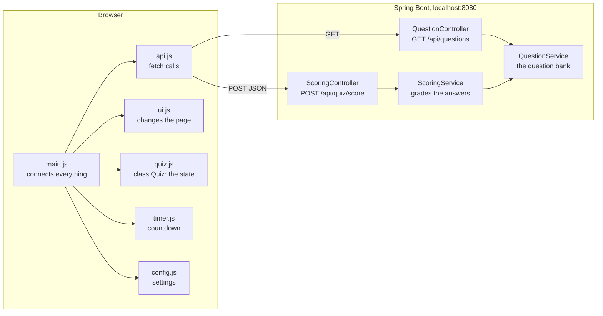

# Quiz App

A small timed quiz in the browser, with a Spring Boot backend that keeps the correct answers and
grades the result. Built to practise JavaScript (modules, promises, classes, timers, keyboard events)
and how a plain JavaScript front end talks to a Java API.

Java 25, Spring Boot 4.2, plain HTML, CSS and JavaScript modules. No database, no frameworks on the
front end: one Maven command runs everything.

## Features

- 5 random questions from a bank of 8, one at a time
- Select an answer, change your mind, confirm with **Next**
- A 20 second countdown per question; when time runs out the question counts as "no answer"
- Keyboard: **1** to **4** to choose, **Enter** for next
- The server grades the answers and returns the score, the correct answers and an explanation per question

## The main idea: the server keeps the secrets

Everything that reaches the browser can be read by the person using it (F12, Network tab). So the
correct answers never leave the server until the quiz is over:

| Step | Browser receives or sends | Server keeps |
|---|---|---|
| Load the quiz | receives `id`, `text`, `choices` | the correct answer and the explanation |
| Finish the quiz | sends `{ questionId, choiceIndex }` for each question | decides what is correct |
| Results | receives the score, the correct answers and the explanations | |

The browser only reports what the player did. The server decides what it means.

## How it fits together



`api.js` knows the server but not the page, `ui.js` knows the page but not the server, and only
`main.js` connects them.

## The API

| Method and path | Body | Answer |
|---|---|---|
| `GET /api/questions?count=5` | | a list of questions **without** the answers (`count` 1 to 8, default 5) |
| `POST /api/quiz/score` | `{"answers":[{"questionId":3,"choiceIndex":1}, ...]}` | `{"correct":4,"total":5,"results":[...]}` |

`choiceIndex` may be `null`, meaning no answer (time ran out). The server answers **400** with a
message when a question is unknown, answered twice, or given a choice that does not exist.

Try it with curl (Windows cmd):

```
curl http://localhost:8080/api/questions?count=2
curl -X POST http://localhost:8080/api/quiz/score -H "Content-Type: application/json" -d "{\"answers\":[{\"questionId\":1,\"choiceIndex\":1}]}"
```

## Run it

You need Java 25. The Maven wrapper downloads Maven by itself.

```
mvnw spring-boot:run
```

Open http://localhost:8080. Stop with Ctrl + C.

The page must be opened through the server, not by double-clicking `index.html`: browsers block
JavaScript modules loaded from `file://`.

## Project layout

```
src/main/java/com/practice/quiz/
  QuizAppApplication.java
  question/Question.java            the full question, including the answer (never sent)
  question/QuestionView.java        what the browser may see: id, text, choices
  question/QuestionService.java     the question bank, random selection, lookup by id
  question/QuestionController.java  GET /api/questions
  scoring/AnswerRequest.java        one answer from the browser
  scoring/ScoreRequest.java         the list of answers
  scoring/AnswerResult.java         the verdict for one question
  scoring/ScoreResponse.java        the score and all verdicts
  scoring/ScoringService.java       grading and the checks against bad requests
  scoring/ScoringController.java    POST /api/quiz/score
src/main/resources/
  application.properties
  static/index.html
  static/css/styles.css
  static/js/main.js, api.js, ui.js, quiz.js, timer.js, config.js
```

## What each step practised

The work was planned in Jira under the epic **Quiz App v1**, one story per commit.

| Key | Story | Main ideas |
|---|---|---|
| QZ-2 | Project, page and JavaScript modules | how a page loads, `import` / `export`, why modules need a server |
| QZ-3 | Questions in Java, sent without the answers | records, DTOs, what Jackson turns into JSON |
| QZ-4 | Load and show the first question | promises, `async` / `await`, the event loop, the two waits in one `fetch` |
| QZ-5 | One question at a time | a `class` for the quiz state, `this`, closures, event delegation |
| QZ-6 | The server grades the answers | `POST` with JSON, JSON to Java records, never trust the client |
| QZ-7 | A countdown per question | `setInterval` / `clearInterval`, measuring against a deadline, stopping timers |
| QZ-8 | Keyboard shortcuts | `keydown`, `event.key` vs `event.code`, default actions, `preventDefault` |

## Limits

This is a learning project: the questions live in Java code, there are no user accounts, and results
are not stored. Showing the correct answers after the quiz also means a player could learn them and
replay; a real exam would reveal results only after it closes.